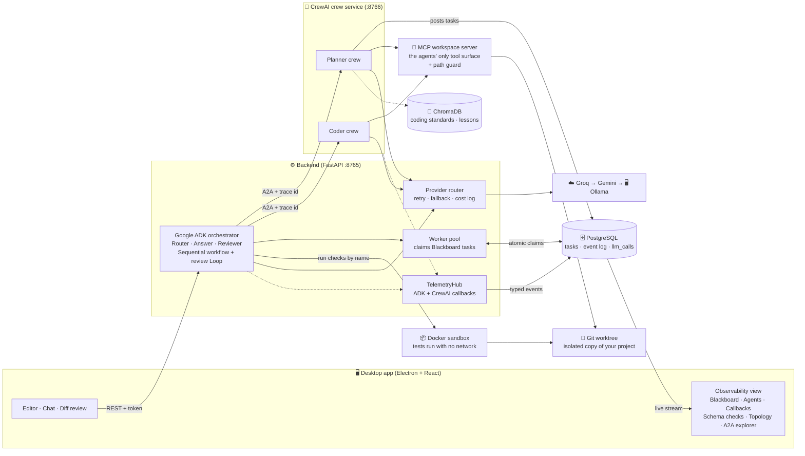
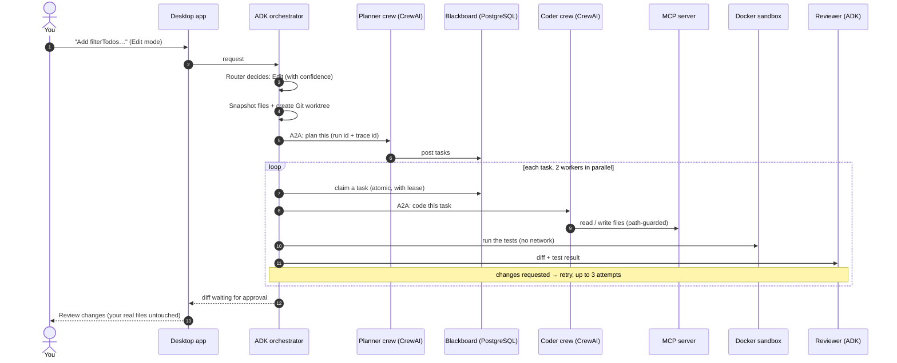

<div align="center">

# 🐝 H.E.X Mind

**Hivemind Execution X: a desktop IDE where a team of AI agents plans, codes, tests and reviews your changes, while you watch them work live.**


[Why](#-why-this-exists) · [Architecture](#-architecture) · [How a run works](#-how-a-run-works) · [Agents](#-the-agents) · [Requirements](#-requirements-coverage) · [Quick start](#-quick-start) · [Try the demo](#-try-the-demo) · [Reference](#-reference)

</div>

---

## 🎯 Why this exists

Most AI coding tools are a single agent doing everything: planning, writing and checking its own work. That causes four problems:

| Problem | How H.E.X Mind answers it |
|---|---|
| **Context overload.** One agent's context window fills up on big tasks. | Specialist agents (Planner, Coder, Reviewer) share a **Blackboard** of tasks. |
| **No independent review.** The agent that wrote the code also judges it. | An independent **ADK Reviewer**. Results come from git and the sandbox, never from agent claims. |
| **No visibility.** When it fails, you don't know why. | A live **Observability view** with an A2A explorer. |
| **Unsafe and unmeasured.** AI-written code runs on your machine, and there is no fair way to compare setups. | An isolated **Git worktree**, a **no-network sandbox**, and a **14-task benchmark** with hidden tests. |

## ✨ What you get

- 💬 **Ask / Edit / Auto chat.** Ask answers from your files, Edit starts an agent run, and Auto lets a Router decide.
- 🧠 **Two frameworks, one protocol.** Google ADK orchestrates, CrewAI crews do the work, and they talk over A2A across a real process boundary.
- 🛡️ **Safe by default.** Agents work in an isolated copy. Your files are untouched until you approve the diff.
- 🔭 **Live observability.** Watch the task board, agents, framework callbacks and A2A messages as they happen.
- 🔁 **Model fallback.** Groq, then Gemini, then local Ollama, with every fallback logged.

> **Status:** phase **P2 of 8** is complete: ADK core, CrewAI crews over A2A, and the observability view with an A2A explorer. See [HEX_Mind_Refined_Plan.md](HEX_Mind_Refined_Plan.md) for the plan.

---

## 🏗️ Architecture



**Reading the diagram**

| Layer | What it does |
|---|---|
| **Desktop app** | Where you work: editor, chat, diff review and the Observability view. |
| **ADK orchestrator** | The manager. It routes your request, runs the workflow, and reviews the result. |
| **CrewAI crew service** | The workers. A separate process that serves the Planner and Coder as A2A agents. |
| **MCP server + worktree** | The only way agents touch files, always inside an isolated copy of your project. |
| **Docker sandbox** | Runs tests with no network, so untrusted code can't reach anything. |
| **PostgreSQL + ChromaDB** | The task board, the event log, every model call, and saved standards and lessons. |
| **Provider router** | Every model call from both frameworks goes through it, with automatic fallback. |

---

## 🔄 How a run works



Every arrow above is recorded as a typed event, which is what the Observability view replays live.

---

## 🤖 The agents

**5 AI agents** across two frameworks, plus plain-Python control agents that run no model.

| Agent | Framework | Job |
|---|---|---|
| **Router** | Google ADK | Decides Ask, Edit or ask-a-question, with a confidence score |
| **Answer** | Google ADK | Answers questions from your files in Ask mode |
| **Planner** | CrewAI | Breaks the request into Blackboard tasks |
| **Coder** | CrewAI | Edits files through the MCP tools |
| **Reviewer** | Google ADK | Approves, requests changes, or blocks, citing file and line |

The **control agents** are ADK workflow agents: a `SequentialAgent` for prepare → plan → execute → finalize, a `LoopAgent` for the Coder ⇄ Review loop, and small steps that apply the acceptance rules. **Workers** (`coder_01`, `coder_02`) claim tasks from the Blackboard. They are orchestrator workers, not separate AI agents.

---

## ✅ Requirements coverage

The project is graded on 11 requirements. Status today:

| # | Requirement | Status | Where |
|---|---|---|---|
| 1 | State sharing: Blackboard vs messaging | 🟡 In progress | `app/blackboard/` (messaging mode still to build) |
| 2 | Tools via MCP (16 tools) | 🟡 In progress | `app/mcp_server/` (6 of 16 live) |
| 3 | Structured output with Pydantic | 🟢 Met | `app/router/`, `app/agents/roles.py`, `app/events/schema.py` |
| 4 | Agentic design patterns, compared | 🟡 In progress | `app/orchestration/run.py` (comparison later) |
| 5 | Monitoring via callbacks | 🟢 Met | `app/telemetry/hub.py` |
| 6 | A2A between ADK and CrewAI | 🟢 Met | `app/a2a/` |
| 7 | Only CrewAI + Google ADK | 🟢 Met | `apps/backend/pyproject.toml` |
| 8 | Guardrails + prompt variants | 🟡 In progress | `app/workspace/`, `app/sandbox/`, `app/context/redact.py` |
| 9 | Observability: tracing, audit, provenance | 🟡 In progress | `app/events/`, `app/telemetry/` |
| 10 | End-to-end evaluation | 🟡 In progress | `app/evaluation/benchmarks/` (runner later) |
| 11 | Cloud deployment | ⚪ Planned | final phase (Google Cloud) |

**4 met · 6 in progress · 1 planned.**

<details>
<summary><b>🗺️ Roadmap (phases P1 to P8)</b></summary>

| Phase | Goal | Status |
|---|---|---|
| M0 to M4 | Electron shell, database, router, CrewAI agents, Blackboard, sandbox, providers, benchmark set | ✅ done |
| **P1** | ADK core, TelemetryHub, event schema v2, Observability UI | ✅ done |
| **P2** | CrewAI crews over A2A, A2A explorer, event schema v3 | ✅ done |
| P3 | The remaining 10 MCP tools and the messaging backend | next |
| P4 | Layered guardrails and prompt variants | planned |
| P5 | Tracing, tamper-proof audit log, provenance | planned |
| P6 | Evaluation runner and experiments | planned |
| P7 | Apply, reject and revert changes | planned |
| P8 | Cloud deployment on Google Cloud | planned |

</details>

---

## 🚀 Quick start

**You need:** Node.js 20+, Python 3.11+ with [uv](https://docs.astral.sh/uv/), Docker Desktop, Git, and [Ollama](https://ollama.com) (`ollama pull qwen2.5-coder:7b` and `ollama pull nomic-embed-text`). Free [Groq](https://console.groq.com) and [Gemini](https://aistudio.google.com) keys are optional but recommended, because local models alone give noticeably weaker code.

**1. Install and configure**

```sh
npm install                          # also downloads the Electron binary
uv --directory apps/backend sync

cp .env.example .env
python -c "import secrets; print(secrets.token_urlsafe(32))"   # paste into HEXMIND_API_TOKEN in .env
```

**2. Start the services**

```sh
npm run db:up                        # PostgreSQL
npm run db:migrate                   # create the tables
docker pull node:22-alpine           # sandbox image
```

**3. Run it** (two terminals)

```sh
npm run dev:backend   # backend on :8765, and it starts the crew service on :8766
npm run dev           # the desktop app
```

> ⚠️ If Electron exits at once with `Cannot read properties of undefined (reading 'whenReady')`, your terminal has `ELECTRON_RUN_AS_NODE=1` set (editor terminals often do). Unset it, for example `env -u ELECTRON_RUN_AS_NODE npm run dev`.

---

## 🎬 Try the demo

1. In the app, click **Open folder** and choose a small Git project (the demo uses a to-do library).
2. Set the chat to **Edit** and send:

   > Create src/filter.js exporting filterTodos(todos, filter) where filter is "all", "active" (not done) or "done"; any other value throws an Error "unknown filter". Also export FILTERS = ["all", "active", "done"]. Add tests in src/filter.test.js.

3. Open the **Observability** view and watch the run:

| Tab | What you will see |
|---|---|
| **Blackboard** | The Planner's tasks, and a worker claiming each one |
| **Agents** | Each agent's state, with ADK and CrewAI badges, and failures marked |
| **Callbacks** | The framework hooks firing live |
| **A2A explorer** | Agent Cards and the request and response lanes, with a shared trace id |
| **Schema checks** | Every model reply validated against its expected form |
| **Topology** | The orchestration pattern |

4. When the run reaches `awaiting_approval`, open **Review changes** to see the diff. Your real files are untouched.

---

## 📚 Reference

<details>
<summary><b>⚙️ Configuration</b></summary>

Everything is set through `HEXMIND_*` variables in `.env` (see [.env.example](.env.example)).

| Variable | Default | Purpose |
|---|---|---|
| `HEXMIND_API_TOKEN` | required | shared secret between the app, the backend and the crew service |
| `HEXMIND_DATA_DIR` | `%LOCALAPPDATA%\hexmind` | run worktrees, memory store, crew storage. Point it at a roomy drive if your system drive is small |
| `HEXMIND_PROVIDER_ORDER` | `["groq","gemini","ollama"]` | fallback order |
| `HEXMIND_CREW_SERVICE_AUTOSTART` | `true` | start the CrewAI crew service with the backend in development |
| `HEXMIND_OTLP_ENDPOINT` | unset | optional OpenTelemetry export target |
| `HEXMIND_REVIEW_MAX_ROUNDS` | `2` | review and retry rounds before a run stops |

</details>

<details>
<summary><b>🧠 Model providers and fallback</b></summary>

Each model call tries the providers in `HEXMIND_PROVIDER_ORDER`: Groq, then Gemini, then Ollama.

| Provider | Setup |
|---|---|
| Ollama (local) | `ollama pull qwen2.5-coder:7b`. No key needed. Used when the hosted providers aren't configured or have failed. |
| Groq | Put `HEXMIND_GROQ_API_KEY=...` in `.env`. The model is `HEXMIND_GROQ_MODEL`. |
| Gemini | Put `HEXMIND_GEMINI_API_KEY=...` in `.env`. The model is `HEXMIND_GEMINI_MODEL`. |

A provider without a key is skipped. A provider that hits its quota, or whose key is rejected, falls back to the next one straight away and is skipped for a cooldown; the run records a `provider_fallback` event. **Settings** (the gear in the activity bar) shows each provider's status, cooldown and remaining rate limit, with a **Test** button. Keys stay in the backend and are never shown.

Cost estimates come from `apps/backend/app/providers/pricing.yaml`. Those prices are **unverified**, so check them against the providers' pricing pages before reporting costs.

Check a provider end to end (the call is logged in `llm_calls`):

```sh
curl -X POST http://127.0.0.1:8765/api/providers/ollama/test -H "Authorization: Bearer <token>"
```

</details>

<details>
<summary><b>🧪 Tests and benchmarks</b></summary>

```sh
npm test               # Vitest (renderer) + pytest (backend; needs `npm run db:up`)
npm run typecheck      # tsc for main/preload and renderer
npm run build          # electron-vite production build
npm run lint:backend   # ruff
```

The full backend suite takes about 10 minutes (256 passed, 2 skipped at P2). Do not run two pytest sessions at once, because they share the test database. Docker-based tests need free disk space on the system drive. The two symlink-escape tests are skipped on Windows unless Developer Mode is enabled.

The event contract lives in `apps/backend/app/events/schema.py`. After changing it, run `npm run gen:events` to regenerate `apps/desktop/src/renderer/src/generated/`. A backend test fails if the committed schema is out of date.

**Benchmark set:** `apps/backend/app/evaluation/benchmarks/` holds 14 tasks on a small to-do codebase, each with a hidden acceptance test and a reference solution.

```sh
cd apps/backend
uv run python -m app.evaluation.benchmarks validate   # each hidden test fails on the seed and passes on the reference
uv run python -m app.evaluation.benchmarks sync       # load the tasks into eval_tasks
```

Routing labels for the evaluation are described in [docs/routing-labels.md](docs/routing-labels.md).

</details>

<details>
<summary><b>📁 Project layout</b></summary>

```
apps/
  desktop/   Electron + React + TypeScript (electron-vite)
    src/main/       main process: window, IPC (folder picker), navigation guards
    src/preload/    contextBridge API (api.ts is the shared contract)
    src/renderer/   React renderer: features/{explorer,editor,chat,runs,observability,settings,workspace}
  backend/   FastAPI (uv)
    app/api/            REST routes (health, projects/files, runs/events, providers, a2a)
    app/orchestration/  ADK orchestrator, run lifecycle, conversation flow
    app/a2a/            CrewAI crew service (python -m app.a2a) and A2A client/protocol
    app/agents/         roles, tools, MCP bridge, ADK LLM adapter
    app/blackboard/     task board with atomic claims and leases
    app/telemetry/      TelemetryHub (ADK callbacks and CrewAI hooks), tracing
    app/providers/      provider interface, Ollama/Groq/Gemini adapters, ProviderRouter
    app/router/         Ask/Edit/Auto routing with schema-validated output
    app/mcp_server/     the agents' only tool surface
    app/sandbox/        Docker check runner and project profile
    app/memory/         ChromaDB coding standards and lessons
    app/workspace/      path guard and file service (the only filesystem access)
    app/events/         per-run, gap-free event log and schema
    app/evaluation/     benchmark task set with hidden acceptance tests
    alembic/            migrations
docs/                 coding standards loaded into memory, routing-label guide
spikes/adk_a2a/       the ADK / A2A / MCP / OpenTelemetry spikes that de-risked P1 and P2
reports/              research report: how comparable projects differ and what to adopt
research_notes/       the notes behind that report
docker-compose.yml    PostgreSQL (127.0.0.1:5433) + test database
```

</details>

<details>
<summary><b>🔒 Security baseline</b></summary>

- The renderer runs with `contextIsolation`, `sandbox` and no `nodeIntegration`. Its only API is `window.hex.getBackend()`, `appInfo()` and `pickWorkspace()`.
- IPC handlers reject calls from frames other than the app's own page. New windows are denied, and only `https:` links open externally.
- The backend binds to loopback only, and every route requires `Authorization: Bearer <HEXMIND_API_TOKEN>`. CORS allows only the renderer origin.
- All file access goes through the backend path guard. It rejects `..`, absolute, drive and UNC paths, alternate data streams, Windows device names, trailing dots and spaces, and symlink escapes, and it refuses writes under `.git/`.
- Checks run in a Docker container with no network, limited CPU and memory, a time limit and a read-only root, using allow-listed images only.
- Saves are compare-and-swap on a content hash, so a save never silently overwrites a newer version on disk.
- Secrets live in `.env`, which is git-ignored. Only `.env.example` is committed.

</details>

<details>
<summary><b>⚠️ Known issues</b></summary>

- `npm audit` reports DOMPurify advisories against `monaco-editor@0.57.0`. Monaco bundles its own copy of DOMPurify 3.4.15 (used to sanitize hover markdown), so npm overrides don't affect the code that runs. The affected modes (`IN_PLACE`, `SAFE_FOR_TEMPLATES`, XHTML parsing) are not the ones Monaco uses, and the editor only renders local workspace content. Upgrade Monaco when a patched release is available.
- `a2a-sdk` is pinned to `~=0.3.10` because CrewAI's A2A code breaks on `a2a-sdk` 1.x, although the A2A protocol itself is at v1.0.
- Free-tier model limits are tight. Groq can hit its token limit after a handful of agent calls, and the local fallback model writes weaker code.

</details>

<details>
<summary><b>🔬 Research</b></summary>

[reports/Multi agent coding project comparison.md](reports/Multi%20agent%20coding%20project%20comparison.md) compares H.E.X Mind with OpenHands, SWE-agent, Aider, Cline, MetaGPT, ChatDev and the observability tools, and ranks what to adopt next. The notes behind it are in `research_notes/`. Its findings were produced without reading this repository's code, so treat its "missing feature" claims as hypotheses to verify.

</details>
